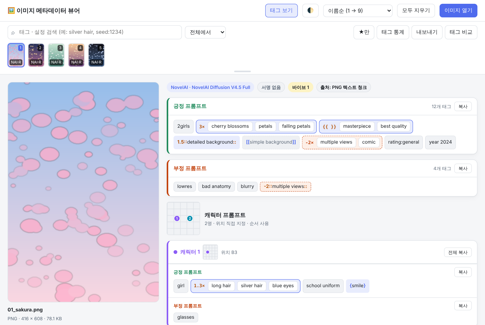
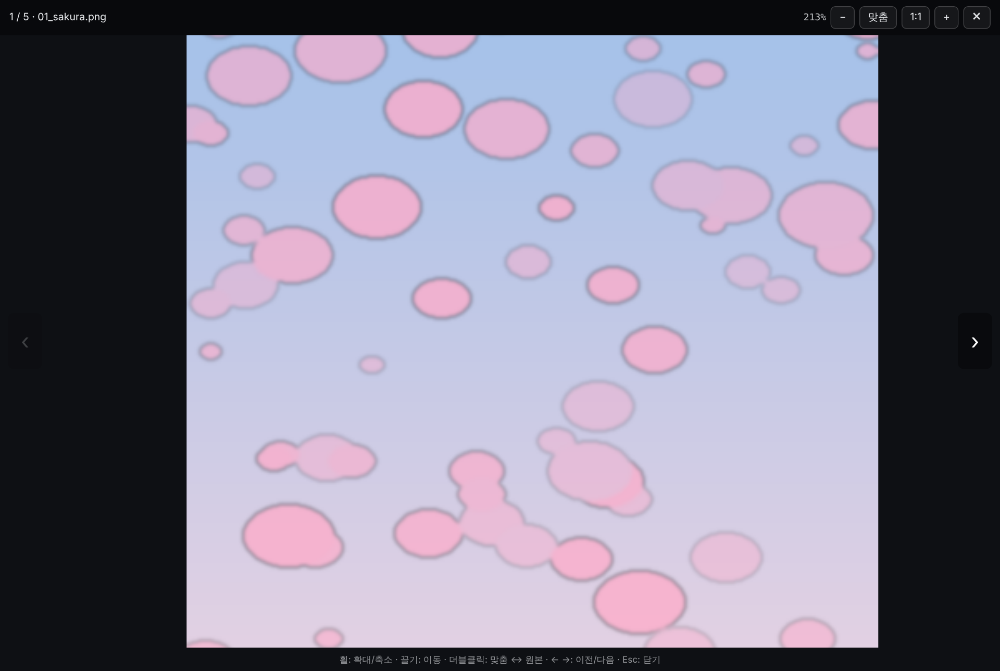
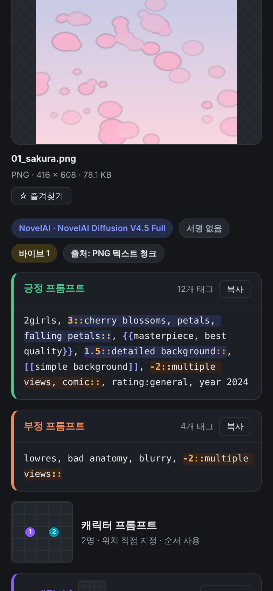

# nai-meta-viewer

NovelAI · Stable Diffusion WebUI · ComfyUI로 만든 이미지에서 **프롬프트와 생성 설정**을 꺼내 읽기 쉽게 보여 주는 뷰어입니다.
NovelAI 이미지는 **긍정 프롬프트 / 부정 프롬프트 / 캐릭터별 프롬프트**로 나누어 보여 줍니다.

**👉 바로 사용하기: https://ohy1.github.io/nai-meta-viewer/**

설치할 것은 없습니다. 이미지를 끌어다 놓으면 바로 분석됩니다.
분석은 모두 **내 브라우저 안에서만** 이뤄지고, 이미지는 어디에도 업로드되지 않습니다.

## 주요 기능

### NovelAI 프롬프트 분리
- 긍정 · 부정 프롬프트를 각각 따로 보여 주고, 버튼 하나로 복사할 수 있습니다.
- **캐릭터 프롬프트**(V4 / V4.5)를 캐릭터마다 긍정 · 부정으로 나누어 보여 줍니다.
  - 캐릭터 위치를 5×5 격자(A1 ~ E5)에 표시합니다.
  - 위치를 AI가 자동으로 고르게 했다면 그렇게 표시합니다.
- 생성 설정을 한눈에 보여 줍니다. 값을 클릭하면 복사됩니다.
  - 모델, 해상도, 스텝, 가이던스, 리스케일, 시드, 샘플러, 노이즈 스케줄, Variety+
- **레퍼런스 · 이미지 입력** 카드에서 레퍼런스를 썼는지 한눈에 봅니다. 항목마다 **사용함 / 사용 안 함** 으로 표시됩니다.
  - **바이브 트랜스퍼**: 개수, 강도, 바이브 데이터 크기. 정보 추출(Information Extracted) 값은 V4 이후 메타데이터에 남지 않아 "기록 안 됨"으로 표시됩니다.
  - **캐릭터 레퍼런스**(V4.5): 종류(캐릭터 / 스타일 / 캐릭터 + 스타일), 강도, Fidelity
  - **이미지 입력**: img2img · 인페인트 여부와 강도, 노이즈
  - 사용한 레퍼런스는 상단 배지로도 표시되고, 썸네일에는 `NAI·R` 처럼 R이 붙습니다.
- V5 이미지는 모델 해시로 **Effort**(High / Medium)를 구분하고, **품질 태그**(None / Standard), **UC 프리셋**(Heavy / Light / Human Focus / Furry Focus / None)도 이름으로 보여 줍니다.
- 그 밖의 파라미터는 "기타 파라미터"에 모두 담겨 있습니다.

### 가중치 문법을 읽기 쉽게
- `{ }` `[ ]` `1.5::태그::` 같은 강조 기호에 색을 입힙니다.
- **태그 보기**를 켜면 쉼표 단위 태그로 나눠 보여 줍니다. 태그를 클릭하면 그 태그만 복사됩니다.
- `3::태그1, 태그2, 태그3::` 나 `{{태그1, 태그2}}` 처럼 여러 태그를 묶은 가중치는 **하나의 묶음 상자**로 보여 줍니다. 쉼표 때문에 그룹이 쪼개지지 않습니다.
  - 강조는 파란 상자, 약화는 회색 점선, 음수 가중치는 붉은 점선으로 구분합니다.
  - 묶음 앞의 `3×` 를 누르면 그룹 전체가 복사됩니다.

### 숨겨진 메타데이터도 찾아냄
- PNG 텍스트 정보가 지워진 NovelAI 이미지라도, 알파 채널에 숨겨진 생성 정보(stealth pnginfo)가 남아 있으면 읽어 냅니다.
- Stable Diffusion WebUI(A1111 / Forge)의 `parameters` 와 JPEG의 EXIF UserComment를 읽습니다.
- ComfyUI 워크플로에서는 KSampler와 연결된 긍정 · 부정 프롬프트를 찾아 보여 줍니다.
- 일반 사진의 EXIF(카메라, 촬영 시각, GPS 등)와 XMP도 "원본 메타데이터"에서 볼 수 있습니다.

### 검색 · 통계 · 비교 · 태그 합성
이미지를 2장 이상 열면 상단에 검색칸과 **★만 · 태그 통계 · 내보내기 · 태그 비교** 버튼이 나타납니다.

- **태그 · 설정 검색**
  - `silver hair` 처럼 입력하면 그 태그가 들어간 이미지만 썸네일 줄에 남고, `2 / 5장` 처럼 개수가 표시됩니다.
  - 쉼표로 여러 조건을 넣으면 모두 만족하는 이미지만 찾습니다. 앞에 `-` 를 붙이면(`-glasses`) 그 조건에 맞는 이미지는 뺍니다.
  - 생성 설정으로도 찾을 수 있습니다.

    | 예 | 뜻 |
    |---|---|
    | `seed:1234` | 시드가 1234 |
    | `steps:>=28` | 스텝 28 이상 (`>` `<` `>=` `<=` 사용 가능) |
    | `scale:5` | 가이던스 5 |
    | `sampler:euler` | 샘플러 이름에 euler 포함 |
    | `model:v4.5` | 모델 이름에 v4.5 포함 |
    | `size:832x1216` | 해상도 |
    | `effort:high` | V5 Effort |
    | `ref:vibe` · `ref:char` · `ref:i2i` | 바이브 / 캐릭터 레퍼런스 / img2img를 쓴 이미지 |
    | `ref:none` · `ref:any` | 레퍼런스를 하나도 안 쓴 / 하나라도 쓴 이미지 |
  - 전체 / 긍정에서만 / 부정에서만 중에서 찾을 범위를 고를 수 있습니다. 캐릭터 프롬프트도 함께 찾습니다.
  - 찾은 태그는 프롬프트 안에서, 찾은 설정은 생성 설정 칸에서 노란색으로 표시됩니다.
  - 검색 중에는 ← → 키와 확대 보기의 이전 / 다음도 검색 결과 안에서만 움직입니다.
- **태그 통계**
  - 열어 둔 이미지(검색 중이면 검색 결과)에서 많이 쓴 태그를 순위로 보여 줍니다. 막대는 몇 %의 이미지에 쓰였는지를 나타냅니다.
  - 태그를 클릭하면 검색에 추가되고, 다시 클릭하면 빠집니다. 클릭할수록 범위가 좁혀지며 함께 쓰인 태그를 볼 수 있습니다.
- **즐겨찾기**
  - 미리보기 아래 **☆ 즐겨찾기** 버튼이나 `F` 키로 표시합니다. 썸네일에 ★이 붙습니다.
  - **★만** 버튼으로 즐겨찾기한 이미지만 봅니다. 표시는 이 브라우저에 저장되어, 같은 파일을 다시 열면 그대로 남아 있습니다.
- **내보내기**
  - 열어 둔 이미지(검색 중이면 검색 결과)의 프롬프트와 설정을 **CSV**(엑셀용) 또는 **TXT** 파일로 저장하거나, TXT 내용을 바로 복사합니다.
  - CSV에는 파일명, 생성 도구, 모델, 긍정 / 부정 / 캐릭터별 프롬프트, 시드, 스텝, 가이던스, 샘플러, 해상도, 즐겨찾기 여부가 들어갑니다.
- **썸네일 미리보기**: 마우스를 썸네일 위에 잠시 올려 두면 프롬프트 요약이 말풍선으로 나옵니다.
- **태그 비교**
  - 지금 보는 이미지가 기준(A)이 되고, 썸네일을 클릭하거나 ← → 키로 비교 대상(B)을 고릅니다.
  - 긍정 · 부정 · 캐릭터별 프롬프트마다 차이를 보여 줍니다.
    - **B에만 있음** (초록)
    - **A에만 있음** (빨강, 취소선)
    - **가중치가 다름** (`A 3` / `B 1.5`)
    - 공통 태그
  - 가중치 묶음 안의 태그도 하나하나 비교합니다.
  - 시드, 가이던스 같은 생성 설정도 다른 항목만 표로 보여 줍니다.
  - A / B 이미지를 클릭하면 확대 보기로 열리고, 확대 보기에서 ← → 로 A와 B를 오갑니다.
  - ⇄ 버튼으로 A와 B를 바꾸고, `Esc` 로 비교를 끝냅니다.
- **태그 합성** (비교 화면 오른쪽, 휴대폰에서는 위쪽)
  - 비교 결과의 태그를 클릭하면 합성 칸에 담깁니다. 줄마다 있는 **모두 담기** 로 한 번에 담을 수도 있습니다.
  - 가중치가 다른 태그는 `A 3` / `B 1.5` 중 원하는 가중치를 골라 담습니다.
  - 각 칸에 태그를 **직접 입력**할 수 있습니다. 쉼표로 여러 개를 넣고 Enter를 누르면 됩니다. `1.2::lens flare::` 처럼 가중치를 붙여 써도 됩니다.
  - 긍정, 부정, 캐릭터별 칸으로 나뉘어 있고, 칸마다 **복사**, 전체는 **전체 복사** 로 가져갑니다.
  - B를 바꿔도 담은 태그는 유지되므로, 여러 이미지에서 필요한 태그만 골라 모을 수 있습니다.
  - 가중치가 1이 아닌 태그는 NAI 형식(`1.5::태그::`)으로 복사됩니다.

### 여러 장 보기와 확대

| 확대 보기 | 휴대폰 (다크 모드) |
|---|---|
|  |  |

- 여러 장을 한 번에 열 수 있습니다.
  - **ZIP 파일**을 넣으면 안에 든 이미지를 꺼내서 함께 보여 줍니다. 폴더 구조와 한글 파일 이름도 그대로 읽습니다.
  - 메타데이터가 없는 이미지는 썸네일이 흐려지고 붉은 **없음** 표시가 붙어서 바로 구분됩니다.
  - 정렬은 **이름순**(1, 2, 10 처럼 숫자도 자연스럽게) 또는 **날짜순** 중에서 고릅니다.
  - 썸네일에 순서 번호가 붙습니다.
- 썸네일 줄 아래 손잡이를 **끌어 내리면** 썸네일이 커집니다. 더블클릭하면 원래 크기로 돌아갑니다.
- 미리보기 이미지를 클릭하면 **확대 보기**가 열립니다.
  - 휠로 확대 · 축소하고, 끌어서 이동합니다.
  - 더블클릭하면 화면 맞춤과 원본 크기가 번갈아 바뀝니다.
  - 휴대폰에서는 두 손가락으로 확대합니다.
- 라이트 · 다크 테마를 지원합니다.

## 사용법

1. https://ohy1.github.io/nai-meta-viewer/ 에 접속합니다.
2. 이미지나 ZIP 파일을 화면에 끌어다 놓거나, **이미지 열기** 버튼을 누르거나, `Ctrl+V` 로 붙여넣습니다.

### 단축키

| 키 | 동작 |
|---|---|
| `←` `→` | 이전 / 다음 이미지 (태그 비교 중에는 비교 대상 B 바꾸기, 비교 화면의 확대 보기에서는 A ↔ B) |
| `/` | 태그 검색칸으로 이동 |
| `F` | 지금 보는 이미지 즐겨찾기 표시 / 해제 |
| `+` `-` | 확대 / 축소 (확대 보기에서) |
| `0` | 화면에 맞춤 (확대 보기에서) |
| `1` | 원본 크기 (확대 보기에서) |
| `Esc` | 확대 보기 닫기 · 내보내기 메뉴 닫기 · 태그 비교 끝내기 |

### 인터넷 없이 쓰기

[`index.html`](index.html) 파일 하나만 내려받아 더블클릭하면 그대로 실행됩니다.
외부 라이브러리나 폰트를 쓰지 않아서 오프라인에서도 똑같이 동작합니다.

## 메타데이터가 안 보일 때

- **SNS · 메신저를 거친 이미지:** 카카오톡, 디스코드, X(트위터) 등에 올렸다 받은 이미지는 메타데이터가 지워지는 경우가 많습니다.
- **복사해서 붙여넣은 이미지:** 브라우저에서 "이미지 복사" 후 붙여넣으면 정보가 사라집니다. 원본 파일을 직접 열어 주세요.
- **날짜순 정렬 기준:** 브라우저는 파일의 "만든 날짜"를 읽을 수 없습니다. 그래서 날짜순 정렬은 파일이 **저장된 시각**을 기준으로 합니다.

## 지원 형식

| 형식 | 읽는 정보 |
|---|---|
| PNG | tEXt · zTXt · iTXt 텍스트 정보, eXIf, 알파 / RGB 채널에 숨겨진 정보 |
| JPEG | EXIF, XMP, 주석(COM) |
| WebP | EXIF, XMP, 알파 채널에 숨겨진 정보 |
| ZIP | 안에 든 PNG · JPEG · WebP 이미지를 꺼내서 위와 같이 분석 (암호 걸린 ZIP, 7z · RAR은 지원하지 않음) |

## AI 사용 안내

이 프로젝트는 [Claude](https://claude.ai)를 이용해서 만들었습니다.

## 라이선스

[MIT License](LICENSE) © 2026 ohy1

이 도구는 NovelAI(Anlatan), Stable Diffusion, ComfyUI와 관련 없는 **비공식 프로젝트**입니다.
각 이름과 상표는 해당 소유자에게 있습니다.
